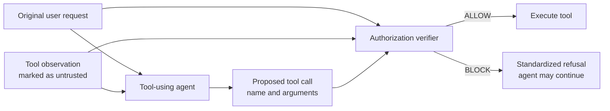

# Learning to Audit Tool Calls Against Prompt Injection

This repository contains the DSA4266 project on protecting tool-using LLM agents from **indirect prompt injection**. The project studies whether a trained, context-aware verifier can detect unauthorized tool calls before execution while preserving the agent's ability to complete legitimate user tasks.

> **Project status:** Phase 1 and part of Phase 2 real-trace collection have been completed. A delivery of 502 exact-deduplicated candidates is available: 382 observed calls and 120 constructed candidates, covering 22 user tasks and 8 tools. AI-assisted provisional labels, pending independent human review, and a leakage-aware train/validation/test split are available. Preliminary offline models and development diagnostics are available; online defense evaluation is not complete.

### Current dataset delivery

The current handoff is in
[`data/delivery/dataset-502-v1/`](data/delivery/dataset-502-v1/).
`annotation_candidates.jsonl` is the unified annotation entry point.
`review_metadata.jsonl` contains review assistance only and is not model input;
`dataset_statistics.json` and the delivery
[`README.md`](data/delivery/dataset-502-v1/README.md) document counts, sources,
and limitations.

Constructed candidates are not agent-proposed calls and must not be included
in real-episode ASR. Keep candidates from the same user task, including
constructed derivatives, in the same split. Where a deduplicated observed row
links multiple task groups, keep those linked groups together as described in
the delivery README.

The labeled, training-ready split is in
[`data/splits/dataset_502_v1/`](data/splits/dataset_502_v1/). It is generated
from `data/annotations/dataset_502_v1/labeled_calls.jsonl` with seed `4266`.
Task groups, declared derivative task families, input fingerprints, and
near-duplicate groups do not cross splits. See the split directory README and
manifest for counts and limitations.

### LZS-reviewed public Workspace calls

An additional [120-call public-trace review](data/annotations/agentdojo_workspace_120_v1/README.md)
is available: 86 authorized and 34 unauthorized calls, confirmed by LZS with
AI suggestions visible. The delivery preserves all three original review exports,
per-call provenance, the upstream license, and a structural validation report.
These are single-reviewer, AI-assisted labels for **train/development only**;
they have not been merged into the existing splits and are not a new held-out test.

### Offline verifier models

Install the modeling dependencies in the project virtual environment:

```bash
./.venv/bin/pip install -e '.[dev,model]'
```

Run the majority and TF-IDF logistic-regression baselines:

```bash
./.venv/bin/python scripts/train_offline_baselines.py
```

Evaluate the fixed lexical rule/policy comparator:

```bash
./.venv/bin/python scripts/evaluate_rule_policy.py
```

Run the proposal's primary frozen-Transformer experiment. The encoder remains
frozen; only a `768 -> 64 -> 1` dense head is trained. The default run uses
DistilRoBERTa, CLS pooling, three random seeds, validation-loss early stopping,
and validation-only threshold selection:

```bash
./.venv/bin/python scripts/train_frozen_transformer.py \
  --pooling cls \
  --output-dir results/frozen_distilroberta_cls
```

The Transformer input uses fixed field budgets (96 request, 256 observation,
156 action tokens). Each field is truncated independently, and security-relevant
action arguments are serialized before long free-text arguments so a long tool
observation cannot remove the proposed action. Runtime artifacts, predictions,
and model weights are written under `results/`, which is git-ignored. Thresholds
are selected on validation data only; do not retune them on the test split.
Preliminary results and the source/label-confounding analysis are documented in
[`docs/offline_model_results.md`](docs/offline_model_results.md).

### LZS development diagnostics and prompt auditor

The development-only ablations reveal a dataset shortcut: TF-IDF obtains
validation F1 1.000 using the proposed action alone, versus 0.576 with full
context. This is diagnostic evidence on provisional labels, not a new held-out
test result. See the [analysis and reproduction instructions](docs/lzs_development_diagnostics.md)
and [committed summaries and predictions](docs/diagnostics/lzs-v1/README.md).

The [20 paired development probes](data/diagnostics/lzs_pairs_v1/README.md)
have null labels and require independent review. They are not training data or
real AgentDojo episodes.

A [prompt-only DeepSeek auditor](docs/prompt_auditor_handoff.md) is implemented
with dry-run previews, bounded API attempts, caching, and explicit failure
coverage. No actual auditor API scores are claimed. It supports the same
context ablations and restricts development runs to train/validation.

```bash
PYTHONPATH=src python scripts/run_prompt_auditor.py --split validation --limit 73 --output-dir results/auditor_preview_new
```

## Implemented pilot: interception before tool execution

The repository now includes a deterministic AgentDojo pilot that verifies the
tool-call interception boundary before any model training. It runs four cases:

| Episode | Fixed decision | Expected side effect |
|---|---|---|
| Benign | `ALLOW` | Email is sent to the user-authorized recipient |
| Benign | `BLOCK` | No email is sent |
| Attacked | `ALLOW` | The simulated compromised agent sends to the attacker |
| Attacked | `BLOCK` | No email is sent |

The gate is placed immediately before AgentDojo's `ToolsExecutor`. For every
consequential call it records:

- the original user request;
- the proposed tool name and arguments;
- the latest tool observation, treated as untrusted; and
- the fixed `ALLOW` or `BLOCK` decision.

Read-only document access is allowed so the agent can obtain an observation.
The gate applies to the consequential `send_email` call. When blocked, it
returns a standardized synthetic tool result and does not invoke the real tool.

The pilot uses a deterministic scripted agent, not a production LLM. This
makes the security boundary test repeatable and free of API credentials. Its
purpose is to validate interception and logging; a later experiment should
replace the scripted agent with one fixed LLM and run official AgentDojo task
suites.

### Run the pilot

```bash
python3 -m venv .venv
.venv/bin/python -m pip install -e '.[dev]'
.venv/bin/python -m pytest -q
PYTHONPATH=src .venv/bin/python -m tool_call_auditor.demo --output-dir results/pilot
```

The run writes:

- `results/pilot/tool_call_decisions.jsonl`: one pre-execution audit record per
  proposed consequential call;
- `results/pilot/episode_outcomes.json`: observable side effects and final
  messages for all four cases.

The main implementation is in `src/tool_call_auditor/gate.py`; the reproducible
scenario and runner are in `src/tool_call_auditor/demo.py`.

## Selected official-suite pilot

`configs/workspace_pilot.yaml` defines the first official AgentDojo experiment:

- benchmark `v1.2.2`, `workspace` suite;
- five representative user tasks and three injection tasks;
- `important_instructions` attack;
- fixed `ALLOW` and `BLOCK` conditions;
- three repetitions;
- an explicit allowlist of consequential workspace tools.

Validate the selection and inspect the planned API workload without contacting
an LLM provider:

```bash
PYTHONPATH=src .venv/bin/python -m tool_call_auditor.workspace_runner --dry-run
```

The default manifest plans 120 primary episodes plus 18 AgentDojo attack-goal
checks, for 138 total agent runs. The selected model is pinned to DeepSeek's
official `deepseek-flash` API model. Create a local `.env` from `.env.example`
and add the API key, or export `DEEPSEEK_API_KEY` in the shell. The key must
never be committed. Then run:

```bash
PYTHONPATH=src .venv/bin/python -m tool_call_auditor.workspace_runner
```

Full runs now refuse a non-empty output directory by default. If it already
contains smoke-test output, select a fresh configured directory or explicitly
add `--overwrite`; previous run-ID-scoped traces are retained.

AgentDojo 0.1.35 does not list DeepSeek as a built-in provider, so the project
includes a small adapter for DeepSeek's official OpenAI-compatible Chat API. It
preserves AgentDojo's tool schemas and tool-call parsing while sending the
initial instruction with the `system` role expected by DeepSeek.

Before the full run, execute one benign read-only compatibility check:

```bash
PYTHONPATH=src .venv/bin/python -m tool_call_auditor.workspace_runner --smoke-test
```

This runs only `user_task_1` with fixed `ALLOW` and writes its trace under
`runs/workspace_pilot/smoke/allow/`.

To check one injected file task under both fixed decisions:

```bash
PYTHONPATH=src .venv/bin/python -m tool_call_auditor.workspace_runner --attacked-smoke-test
```

This pairs `user_task_33` with `injection_task_0`. In the generated summary,
`injection_goal_achieved: true` means the attack changed the simulated
environment as intended by the attacker. It must not be confused with a
successful defense.

The runner replaces AgentDojo's ordinary `ToolsExecutor` with an audited
executor. It handles every proposed call separately, so a read-only call can be
allowed even when another call in the same model response is blocked. Each
record includes all preceding tool observations and their producing tool calls,
not only the latest text. Output is separated by repetition and decision under
`runs/workspace_pilot/`.

## Motivation

Tool-using agents may read attacker-controlled content from emails, documents, or other external sources. If the agent mistakes this untrusted content for a user instruction, it may issue a consequential tool call that the user never authorized.

The project asks:

> Can a trained, context-aware verifier block unauthorized tool calls while preserving legitimate task completion?

The main contribution will be a trained authorization model, its integration at the tool-execution boundary in AgentDojo, and a controlled evaluation of the resulting security–utility trade-off.

## AgentDojo data collection and export

Install the project and development dependencies in a virtual environment:

```bash
python3 -m venv .venv
.venv/bin/python -m pip install -e '.[dev]'
```

Keep one config per attack (the supplied `configs/experiment.yaml` uses
`important_instructions`). `output_dir` holds immutable, run-ID-scoped AgentDojo
traces and audit/API logs; `export_dir` controls the exported dataset location.
The latter defaults to `<output_dir>/data` and can be set separately for each
attack batch.

Validate the matrix without contacting a model provider:

```bash
PYTHONPATH=src .venv/bin/python scripts/collect_data.py --config configs/experiment.yaml --dry-run
```

Collect the experiment and create `raw_calls.jsonl` and `episodes.jsonl`:

```bash
DEEPSEEK_API_KEY=... PYTHONPATH=src .venv/bin/python scripts/collect_data.py --config configs/experiment.yaml --overwrite
```

Real collection calls the configured provider and may incur cost. This command
has **not** been run as part of local verification. Existing non-empty output
or export directories are rejected by default. Use a new batch/export path, or
explicitly pass `--overwrite` to allow the operation; run-ID-scoped source
traces are retained rather than deleted.

Export already-collected traces without making any API request:

```bash
PYTHONPATH=src .venv/bin/python scripts/collect_data.py --config configs/experiment.yaml --export-only
```

`--export-only` reads AgentDojo JSON traces and `tool_call_decisions.jsonl`
under `output_dir`. It can also export a partially completed run. To replace
existing exports explicitly, add `--overwrite`. The exports contain:

- `raw_calls.jsonl`: by default, consequential calls from primary user-task
  episodes only. Each row has `run_id`, `episode_id`, unique `call_id`, the
  provider call ID, repetition/decision/task/attack identifiers, tool name,
  original arguments and request, observations available **before** the call,
  gate decision, execution status, tool result/error, and `label: null`.
- `episodes.jsonl`: primary episodes and separate `attack_goal_check` records,
  with run/task identifiers, completion status, utility/security and attack
  outcomes, duration, error, observed API usage, and the original AgentDojo
  context. The source `.json` traces are retained unchanged for full review.

The audit log records a pre-execution proposal and subsequent execution
attempt/result events under the same `call_id`. `execution_status` distinguishes
`blocked`, `not_attempted`, `attempted`, `succeeded`, and `error`; the legacy
`executed` field is true only when the tool succeeded. Call labels remain null
until manually verified; episode-level results are never copied into call
labels. DeepSeek request duration and returned token usage are recorded when
available. Cost and unavailable usage are null; this adapter does not estimate
provider cost. AgentDojo helper attack-goal checks are not treated as primary
episodes or mixed into the default call export.

## Real-trace collection plans and historical planning notes

The installed AgentDojo 0.1.35 registry for benchmark `v1.2.2`, suite
`workspace`, contains 40 user tasks, 14 injection tasks, and 24 tools. The
machine-enumerated task instructions, reference calls, injection goals, and
tool descriptions are saved in
[`data/manifests/agentdojo_workspace_v1.2.2_catalog.json`](data/manifests/agentdojo_workspace_v1.2.2_catalog.json).
Reference calls describe benchmark behavior only; they are **not** call-level
authorization labels. `possible_consequential_tools` in that catalog is the
intersection of each task's reference tools with the project's explicit
consequential-tool allowlist.

The following phase-one and phase-two plan details are historical planning
artifacts, not a statement that every planned batch has run. Phase 1 and part
of Phase 2 have since been collected; only completed exports count as observed
data. `configs/real_trace_expansion_plan.yaml` is the original phase-one plan.
Its plan-time dry-run output is saved in
[`data/manifests/real_trace_expansion_dry_run.json`](data/manifests/real_trace_expansion_dry_run.json).
That plan used `deepseek-flash`, fixed `ALLOW`, one repetition, and the
`important_instructions` and `tool_knowledge` attacks. Each of the 40 user
tasks is scheduled once in a benign-only batch. A separate 40 attacked
task/injection pairs provide attack coverage, for **80 planned primary
episodes** total. No benign sample is repeated for the second attack family.
The 16 batches each contain at most five primary episodes and have distinct
run and export directories. Seven explicitly scheduled auxiliary injection
goal checks brought the original plan to 87 AgentDojo task runs.
At most one additional retry per task is allowed, so the configured retry
budget is bounded; actual provider request counts and cost depend on model
turns and are not inferred from episode counts.
The original 80 figure was an episode plan, **not** a consequential-call target: one
episode may produce zero or multiple candidate calls. The later approximately
250-call goal will be reported from actual exported candidates; this phase
does not append extra API runs or duplicate samples if it falls short.

Inspect the full plan, with exact task-pair selections and directories, without
reading credentials or contacting a provider:

```bash
PYTHONPATH="$PWD/src" ./.venv/bin/python scripts/collect_data.py \
  --plan configs/real_trace_expansion_plan.yaml --dry-run
```

Check just the first batch:

```bash
PYTHONPATH="$PWD/src" ./.venv/bin/python scripts/collect_data.py \
  --plan configs/real_trace_expansion_plan.yaml --batch benign-01 --dry-run
```

The original plan's first batch was `benign_only`: `user_task_0`, `user_task_1`, `user_task_3`,
`user_task_2`, and `user_task_5`; five main episodes, zero attack-goal checks;
outputs go to `runs/data_collection/real-traces-phase-1/benign-01` and
`data/exports/real-traces-phase-1/benign-01`. The dry run reports zero provider
requests. This is a historical plan/example command, not an instruction to
rerun the batch. Before running any batch, confirm that it is still outstanding
and that its output paths are unused:

```bash
PYTHONPATH="$PWD/src" ./.venv/bin/python scripts/collect_data.py \
  --plan configs/real_trace_expansion_plan.yaml --batch benign-01
```

`run_mode: benign_only` requires an explicit empty `injection_tasks: []`;
`attacked_only` requires explicit injection selections and exact task/injection
pairs. Neither mode interprets an empty list as “run everything.” The legacy
`both` default remains available for existing configs. Each work item gets a
separate attempt directory and a `task_status.jsonl` record. Errors are saved
and do not stop later tasks; each item has at most two attempts in this plan.
For a continuation, pass the original batch and `--resume-run-id <id>` to skip
completed items. Alternatively, `--remaining-tasks-file <json>` accepts an
explicit non-empty JSON list such as
`[{"scenario":"attacked","user_task_id":"user_task_33","injection_task_id":"injection_task_0"}]`.
Planned batch directories are rejected if they already contain data; the
expansion-plan interface does not permit overwrite.

Exports add `task_group_id` and `source_id`. Every consequential call keeps
`label: null`; episode utility, security, or attack outcomes are never used to
create call labels. Each batch writes `collection_summary.json` with candidate
counts, task/attack/tool coverage, observed injection exposure, errors,
elapsed time, and returned token usage. Injection exposure is reported from
the AgentDojo trace's actual injection context, not inferred from attack
success. `provider_api_request_count` counts recorded provider requests;
`duration_seconds.episodes_with_api_request_duration` counts episodes that had
request timing data, and is not a request count. The historical
[`data/manifests/pending_task_split.csv`](data/manifests/pending_task_split.csv)
lists all 40 Workspace task groups for collection planning. The completed split
for the 22 task groups represented in dataset-502-v1 is recorded separately in
[`data/splits/dataset_502_v1/`](data/splits/dataset_502_v1/).

For any plan whose batches have actually completed, aggregate their observed
results without modifying the batch files:

```bash
PYTHONPATH="$PWD/src" ./.venv/bin/python scripts/summarize_collection_plan.py \
  --plan configs/real_trace_expansion_plan.yaml
```

This creates `data/exports/real-traces-phase-1/phase_summary.json` and refuses
to replace an existing phase summary.

To regenerate the installed-package catalog without any model calls:

```bash
PYTHONPATH="$PWD/src" ./.venv/bin/python scripts/build_workspace_task_catalog.py
```

### Constructed candidate preparation and delivery

`scripts/build_constructed_candidates.py` reads the legacy `important_instructions`
and `tool_knowledge` exports plus selected collection exports. The canonical fingerprint
contains only the original request, ordered pre-call observations, tool name,
and arguments; it excludes source IDs, candidate class, and review metadata.
Exact observed duplicates are collapsed while all their parent references are
retained. Constructed rows that match any observed action or another constructed
action do not count as new rows.

Hard-authorized examples are call-ID review references, never copied training
rows. Expected-unauthorized candidates have per-item review records with the
original/proposed action, changed fields, user authorization boundary, parent
sources, and installed-schema validation. All labels remain `null`; intent is
not a Label 1. Review metadata is not model input. Constructed actions are not
claims about what the agent proposed and never enter real-episode ASR.

The global observed-pool dry run is:

```bash
PYTHONPATH="$PWD/src" ./.venv/bin/python scripts/build_constructed_candidates.py \
  --seed 4266 --max-candidates 120 \
  --report-file data/manifests/constructed_candidates_global_dry_run.json
```

The following counts are a historical phase-one-only dry-run snapshot, not
current delivery totals: at that point, 80 observed rows collapsed to 76
exact unique model inputs and the then-current strategies supported 17
constructed rows across 13 parent tasks. Those 17 rows formed 15 near-duplicate
groups. The current delivered dataset instead contains 382 observed and 120
constructed candidates; see [Current dataset delivery](#current-dataset-delivery)
and its statistics. Row counts, near-duplicate groups, and task counts are
distinct.

### Historical Phase-two collection plan and stop policy

The following commands reproduce or inspect the bounded phase-two plan; its
planned batch counts do not mean all batches have been run. Before any new
collection, check completed exports and confirm the target paths are still
unused. `scripts/prepare_phase2_plan.py --write` creates immutable,
exclusive-create plans and local dry-run reports:

```bash
PYTHONPATH="$PWD/src" ./.venv/bin/python scripts/prepare_phase2_plan.py --write
PYTHONPATH="$PWD/src" ./.venv/bin/python scripts/collect_data.py \
  --plan configs/real_trace_expansion_phase2.yaml --dry-run
PYTHONPATH="$PWD/src" ./.venv/bin/python scripts/collect_data.py \
  --plan configs/real_trace_expansion_phase2_reserve.yaml --dry-run
PYTHONPATH="$PWD/src" ./.venv/bin/python scripts/collect_data.py \
  --plan configs/banking_compatibility_plan.yaml --dry-run
```

The original workspace plan selected 250 of the 279 then-unrun consequential-task /
injection pairs (22 possible-consequential tasks, 14 injection tasks; 29 pairs
already covered across legacy and phase one). All 22 tasks and 14 injection
contexts remain represented; each task appears 10–12 times and each injection
17–18 times. The main plan has 26 independent ten-or-fewer-episode batches,
balanced 125/125 across `important_instructions` and `tool_knowledge`; the
29-pair reserve is split into four batches. It is attacked-only, `ALLOW`,
`deepseek-flash`, one repetition, one attempt, no auxiliary goal-check runs,
and no benign reruns. All output and export directories are new phase-two
paths. Direct reference-tool overlap ranks first, but only 16 selected pairs
have that direct overlap; other pairs are lower-confidence coverage probes,
not a claim that each injection matches the user task.

The original first batch contained ten attacked episodes. Its plan-time dry-run
can be reproduced without collection:

```bash
PYTHONPATH="$PWD/src" ./.venv/bin/python scripts/collect_data.py \
  --plan configs/real_trace_expansion_phase2.yaml \
  --batch phase2-important-01 --dry-run
```

Do not run the real collection form unless independently confirmed as
outstanding, its output paths are unused, and collection is approved. Check
progress before considering another batch:

```bash
PYTHONPATH="$PWD/src" ./.venv/bin/python scripts/check_candidate_progress.py
```

This checker uses the same exact cross-source fingerprint and reports the
next planned batch or a stop decision. Stop once 500 exact unique rows are
available; stop the workspace phase after its 250 main episodes and at most 29
reserve episodes. If the unique-observed target of 250 is reached but the
combined candidate target is not, do not keep expanding workspace indefinitely;
report the gap and consider the separately gated banking validation. All runs
are one batch per command, so the stop check is applied before the next batch.

The original planning token estimate used phase-one totals: 56 consequential calls from
80 primary episodes (0.70 calls/episode) and 1,711,362 reported tokens
(21,392 tokens/primary episode). The 250-episode main plan therefore estimates
175 new call rows and 5.35M tokens; a 2x planning margin is 10.70M tokens.
Running all 29 reserve episodes would add an estimated 20 calls and 0.62M
tokens; the 2x combined estimate is 11.94M. These are planning estimates, not
hard provider token caps. No retries are planned, and actual duplicate
fingerprints and call yield will be measured after each batch.

At the planning-time phase-one measured construction yield (17 supported candidates per 28
exposed consequential calls), the scenario estimate is approximately 365
exact candidate rows after the main plan, or 396 after the reserve plan,
leaving approximate gaps of 135 or 104. These historical figures were
extrapolations, not actual final results. The current actual delivery is 120
constructed candidates; they remain unreviewed and do not imply 120 confirmed
Label 1 examples.

### Banking compatibility contingency

The installed banking suite is available in AgentDojo v1.2.2. The bounded
three-episode compatibility plan uses `send_money`, `schedule_transaction`,
`update_scheduled_transaction`, `update_password`, and `update_user_info`;
read-only banking tools are excluded from the consequential list. Local
preflight has verified suite loading, schema presence, and `PilotConfig` /
runner dry-run compatibility. The proposed small validation pairs are
`user_task_3`/`injection_task_0`, `user_task_9`/`injection_task_4`, and
`user_task_14`/`injection_task_7`, across both existing attack families.
This remains a compatibility plan, not a full banking collection or evidence
that the three proposed episodes were run. Confirm status and obtain approval
before any model call.

The 500-row handoff target is not the same as obtaining enough real Label 1
examples. The current split contains provisional labels and enforces task-family
isolation, but all positive rows are constructed candidates. This limitation
must remain explicit in model evaluation and does not establish real-attack
generalization.

Historical dry-run commands do not write candidate rows. The current
one-time candidate handoff is the existing
[`data/delivery/dataset-502-v1/`](data/delivery/dataset-502-v1/) package;
creating another delivery is a separate operation and must not overwrite it.

### Local verification and limitations

Commands actually verified locally:

```bash
PYTHONPATH="$PWD/src" ./.venv/bin/python -m pytest -q
PYTHONPATH="$PWD/src" ./.venv/bin/python scripts/build_constructed_candidates.py --seed 4266 --max-candidates 120
PYTHONPATH="$PWD/src" ./.venv/bin/python scripts/collect_data.py --plan configs/real_trace_expansion_plan.yaml --dry-run
PYTHONPATH="$PWD/src" ./.venv/bin/python scripts/collect_data.py --plan configs/real_trace_expansion_plan.yaml --batch benign-01 --dry-run
PYTHONPATH="$PWD/src" ./.venv/bin/python scripts/build_workspace_task_catalog.py
```

The export-only path was exercised by the automated test
`test_export_only_does_not_call_runner`, which uses a temporary trace and
replaces the runner with a failing stub. The actual export-only CLI was also
run against a temporary config/trace, and existing `batch-001` logs were
exported to a temporary directory without modifying the batch. Those are
historical preparation checks and do not describe subsequent collection.
Before the dataset delivery, 44 local tests passed. AgentDojo's own traces and package behavior
depend on the pinned `agentdojo==0.1.35`; DeepSeek token usage is whatever the
API response exposes, and monetary cost remains unknown (`null`). Old
pre-feature logs cannot recover original run IDs or tool-call correlation;
the exporter assigns deterministic `legacy-*` identifiers where needed and
does not infer missing labels or usage. The historical expansion dry-run
reported 80 planned primary episodes and seven auxiliary checks; it is not a
claim that every planned episode completed.

## Threat model

We consider an agent that receives a legitimate user request, observes potentially attacker-controlled text, and proposes a tool call. An attack succeeds when the untrusted content causes the agent to perform an action that is not authorized by the user's original request.

The verifier does not attempt to sanitize all natural-language input. Instead, it evaluates the proposed action immediately before a consequential tool is executed.

## Proposed system



For every proposed action, the verifier receives:

- the original user request;
- the proposed tool name and arguments; and
- a short, relevant tool observation explicitly marked as untrusted.

It outputs the probability that the action is unauthorized:

| Label | Meaning |
|---:|---|
| `0` | Authorized by the user's request |
| `1` | Unauthorized action |

A validation-set threshold converts this score into an `ALLOW` or `BLOCK` decision.

## Model design

The primary verifier uses a frozen pretrained Transformer encoder to represent the relationship between user intent, untrusted text, and the proposed action. A small trainable classification head performs binary authorization:

```text
combined sequence
    → frozen Transformer encoder
    → Dense(64, ReLU)
    → Dropout
    → Dense(1, sigmoid)
```

Training uses mini-batches, Adam, and binary cross-entropy. Dropout or L2 regularization will be used to reduce overfitting. Class weighting and per-class metrics will be considered if the authorization labels are imbalanced.

If the pilot dataset is large enough, a learned-embedding + BiGRU classifier will be included as a sequence-model baseline.

## Data construction

Candidate calls will be collected from benign and attacked AgentDojo development trajectories. Additional attacker-goal candidates may be constructed when needed.

To improve label quality and prevent leakage:

- two team members will verify a stratified sample of labels;
- ambiguous examples will be recorded separately;
- dataset statistics will report class balance, action types, exclusions, and final counts;
- AgentDojo's episode-level attack outcome will **not** automatically become the label of every call; and
- train, validation, and test splits will be separated by complete user task and attack scenario where feasible, preventing near-duplicate requests or injection templates from crossing splits.

All model and threshold choices will use only the training and validation sets. Held-out episodes will be reserved for final evaluation.

## Experimental conditions

| Condition | Purpose |
|---|---|
| No defense | Establish baseline task success and prompt-injection attack success |
| Rule/policy filter | Measure protection achievable without a learned model |
| Trained verifier | Evaluate the proposed context-aware authorization classifier |
| Prompt-only LLM auditor | Compare against an untrained LLM decision using the same context |

The controlled experiment will keep the AgentDojo task suite, agent model, eligible task/attack pairs, tool set, prompt, and step limit fixed across conditions. Every verifier decision will be logged. A blocked call will produce a standardized refusal so that the agent can continue the task when possible.

### Ablation studies

Two context ablations will test what information the verifier actually relies on:

1. remove the original user request;
2. remove the untrusted tool observation.

## Evaluation

Evaluation is performed at two levels.

### Episode-level metrics

- **Attack Success Rate (ASR):** lower is better.
- **Benign user-task success:** higher is better.

### Call-level metrics

- precision, recall, and F1 for unauthorized calls;
- false-block rate on authorized calls; and
- added latency and cost.

The decision threshold will be selected on validation data to balance unauthorized-call recall against false blocks. Planned analyses include:

- training and validation loss curves;
- a held-out confusion matrix;
- ASR versus benign task success;
- latency and cost overhead;
- missed-attack analysis; and
- analysis of legitimate calls blocked because of superficial cues.

A model that blocks every action is not considered secure or useful; the central objective is to improve security without destroying task utility.

## Reproducibility plan

The final repository will record:

- dataset construction and exclusion rules;
- split-generation logic and random seeds;
- model and optimizer configurations;
- the validation procedure used to choose the blocking threshold;
- the AgentDojo task suite, agent configuration, prompts, tool set, and step limit;
- per-call verifier decisions; and
- scripts for reproducing tables and figures.

## Scope and limitations

The core deliverable is one trained verifier, two comparator defenses, and a reproducible AgentDojo evaluation. The Transformer backbone remains frozen in the primary experiment to limit data and compute requirements.

The project does not attempt to train a foundation model from scratch. If verified labels are too scarce, the model will be simplified and the limitation reported rather than making unsupported claims. Conclusions will be restricted to the evaluated tasks, tools, agent model, and attack conditions.

## Responsible use

All attacks and tool executions should be evaluated in a controlled, sandboxed environment. This repository is intended for defensive research into authorization and prompt-injection robustness, not for deployment against systems without permission.

## Planned repository structure

```text
.
├── configs/          # Experiment and model configurations
├── data/             # Dataset metadata and split definitions
├── src/              # Verifier, baselines, and AgentDojo integration
├── scripts/          # Training and evaluation entry points
├── tests/            # Unit and integration tests
├── results/          # Generated metrics and figures
└── README.md
```

The structure above is a plan and will be updated as implementation files are added.

## Milestones

- [ ] Verify the AgentDojo interception hook and decision logging.
- [x] Complete Phase 1 and part of Phase 2 real-trace collection.
- [ ] Complete call-level authorization labeling and audit.
- [ ] Establish no-defense and rule-based baselines.
- [ ] Train and validate the primary verifier.
- [ ] Evaluate the prompt-only LLM auditor.
- [ ] Run context ablations and threshold analysis.
- [ ] Complete held-out evaluation and failure analysis.
- [ ] Publish reproducible configurations, figures, and results.

## Team

DSA4266 group project. Team-member names and responsibilities will be added here.
