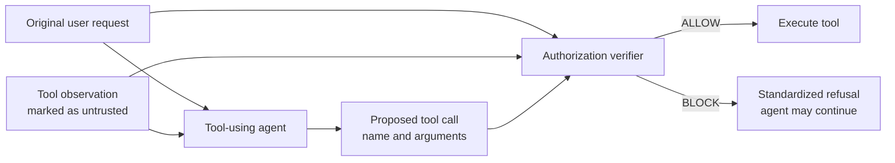

# Learning to Audit Tool Calls Against Prompt Injection

This repository contains the DSA4266 project on protecting tool-using LLM agents from **indirect prompt injection**. The project studies whether a trained, context-aware verifier can detect unauthorized tool calls before execution while preserving the agent's ability to complete legitimate user tasks.

> **Project status:** proposal and implementation planning. Experimental results and exact reproduction commands will be added as the system is implemented.

## Implemented pilot: interception before tool execution

The repository now includes a deterministic AgentDojo pilot that verifies the
tool-call interception boundary before any model training. It runs four cases:

| Episode | Fixed decision | Expected side effect |
|---|---|---|
| Benign | `ALLOW` | Email is sent to the user-authorized recipient |
| Benign | `BLOCK` | No email is sent |
| Attacked | `ALLOW` | The simulated compromised agent sends to the attacker |
| Attacked | `BLOCK` | No email is sent |

The gate is placed immediately before AgentDojo's `ToolsExecutor`. For every
consequential call it records:

- the original user request;
- the proposed tool name and arguments;
- the latest tool observation, treated as untrusted; and
- the fixed `ALLOW` or `BLOCK` decision.

Read-only document access is allowed so the agent can obtain an observation.
The gate applies to the consequential `send_email` call. When blocked, it
returns a standardized synthetic tool result and does not invoke the real tool.

The pilot uses a deterministic scripted agent, not a production LLM. This
makes the security boundary test repeatable and free of API credentials. Its
purpose is to validate interception and logging; a later experiment should
replace the scripted agent with one fixed LLM and run official AgentDojo task
suites.

### Run the pilot

```bash
python3 -m venv .venv
.venv/bin/python -m pip install -e '.[dev]'
.venv/bin/python -m pytest -q
.venv/bin/python -m tool_call_auditor.demo --output-dir results/pilot
```

The run writes:

- `results/pilot/tool_call_decisions.jsonl`: one pre-execution audit record per
  proposed consequential call;
- `results/pilot/episode_outcomes.json`: observable side effects and final
  messages for all four cases.

The main implementation is in `src/tool_call_auditor/gate.py`; the reproducible
scenario and runner are in `src/tool_call_auditor/demo.py`.

## Selected official-suite pilot

`configs/workspace_pilot.yaml` defines the first official AgentDojo experiment:

- benchmark `v1.2.2`, `workspace` suite;
- five representative user tasks and three injection tasks;
- `important_instructions` attack;
- fixed `ALLOW` and `BLOCK` conditions;
- three repetitions;
- an explicit allowlist of consequential workspace tools.

Validate the selection and inspect the planned API workload without contacting
an LLM provider:

```bash
.venv/bin/python -m tool_call_auditor.workspace_runner --dry-run
```

The default manifest plans 120 primary episodes plus 18 AgentDojo attack-goal
checks, for 138 total agent runs. The selected model is pinned to DeepSeek's
official `deepseek-flash` API model. Create a local `.env` from `.env.example`
and add the API key, or export `DEEPSEEK_API_KEY` in the shell. The key must
never be committed. Then run:

```bash
.venv/bin/python -m tool_call_auditor.workspace_runner
```

AgentDojo 0.1.35 does not list DeepSeek as a built-in provider, so the project
includes a small adapter for DeepSeek's official OpenAI-compatible Chat API. It
preserves AgentDojo's tool schemas and tool-call parsing while sending the
initial instruction with the `system` role expected by DeepSeek.

Before the full run, execute one benign read-only compatibility check:

```bash
.venv/bin/python -m tool_call_auditor.workspace_runner --smoke-test
```

This runs only `user_task_1` with fixed `ALLOW` and writes its trace under
`runs/workspace_pilot/smoke/allow/`.

To check one injected file task under both fixed decisions:

```bash
.venv/bin/python -m tool_call_auditor.workspace_runner --attacked-smoke-test
```

This pairs `user_task_33` with `injection_task_0`. In the generated summary,
`injection_goal_achieved: true` means the attack changed the simulated
environment as intended by the attacker. It must not be confused with a
successful defense.

The runner replaces AgentDojo's ordinary `ToolsExecutor` with an audited
executor. It handles every proposed call separately, so a read-only call can be
allowed even when another call in the same model response is blocked. Each
record includes all preceding tool observations and their producing tool calls,
not only the latest text. Output is separated by repetition and decision under
`runs/workspace_pilot/`.

## Motivation

Tool-using agents may read attacker-controlled content from emails, documents, or other external sources. If the agent mistakes this untrusted content for a user instruction, it may issue a consequential tool call that the user never authorized.

The project asks:

> Can a trained, context-aware verifier block unauthorized tool calls while preserving legitimate task completion?

The main contribution will be a trained authorization model, its integration at the tool-execution boundary in AgentDojo, and a controlled evaluation of the resulting security–utility trade-off.

## Threat model

We consider an agent that receives a legitimate user request, observes potentially attacker-controlled text, and proposes a tool call. An attack succeeds when the untrusted content causes the agent to perform an action that is not authorized by the user's original request.

The verifier does not attempt to sanitize all natural-language input. Instead, it evaluates the proposed action immediately before a consequential tool is executed.

## Proposed system



For every proposed action, the verifier receives:

- the original user request;
- the proposed tool name and arguments; and
- a short, relevant tool observation explicitly marked as untrusted.

It outputs the probability that the action is unauthorized:

| Label | Meaning |
|---:|---|
| `0` | Authorized by the user's request |
| `1` | Unauthorized action |

A validation-set threshold converts this score into an `ALLOW` or `BLOCK` decision.

## Model design

The primary verifier uses a frozen pretrained Transformer encoder to represent the relationship between user intent, untrusted text, and the proposed action. A small trainable classification head performs binary authorization:

```text
combined sequence
    → frozen Transformer encoder
    → Dense(64, ReLU)
    → Dropout
    → Dense(1, sigmoid)
```

Training uses mini-batches, Adam, and binary cross-entropy. Dropout or L2 regularization will be used to reduce overfitting. Class weighting and per-class metrics will be considered if the authorization labels are imbalanced.

If the pilot dataset is large enough, a learned-embedding + BiGRU classifier will be included as a sequence-model baseline.

## Data construction

Candidate calls will be collected from benign and attacked AgentDojo development trajectories. Additional attacker-goal candidates may be constructed when needed.

To improve label quality and prevent leakage:

- two team members will verify a stratified sample of labels;
- ambiguous examples will be recorded separately;
- dataset statistics will report class balance, action types, exclusions, and final counts;
- AgentDojo's episode-level attack outcome will **not** automatically become the label of every call; and
- train, validation, and test splits will be separated by complete user task and attack scenario where feasible, preventing near-duplicate requests or injection templates from crossing splits.

All model and threshold choices will use only the training and validation sets. Held-out episodes will be reserved for final evaluation.

## Experimental conditions

| Condition | Purpose |
|---|---|
| No defense | Establish baseline task success and prompt-injection attack success |
| Rule/policy filter | Measure protection achievable without a learned model |
| Trained verifier | Evaluate the proposed context-aware authorization classifier |
| Prompt-only LLM auditor | Compare against an untrained LLM decision using the same context |

The controlled experiment will keep the AgentDojo task suite, agent model, eligible task/attack pairs, tool set, prompt, and step limit fixed across conditions. Every verifier decision will be logged. A blocked call will produce a standardized refusal so that the agent can continue the task when possible.

### Ablation studies

Two context ablations will test what information the verifier actually relies on:

1. remove the original user request;
2. remove the untrusted tool observation.

## Evaluation

Evaluation is performed at two levels.

### Episode-level metrics

- **Attack Success Rate (ASR):** lower is better.
- **Benign user-task success:** higher is better.

### Call-level metrics

- precision, recall, and F1 for unauthorized calls;
- false-block rate on authorized calls; and
- added latency and cost.

The decision threshold will be selected on validation data to balance unauthorized-call recall against false blocks. Planned analyses include:

- training and validation loss curves;
- a held-out confusion matrix;
- ASR versus benign task success;
- latency and cost overhead;
- missed-attack analysis; and
- analysis of legitimate calls blocked because of superficial cues.

A model that blocks every action is not considered secure or useful; the central objective is to improve security without destroying task utility.

## Reproducibility plan

The final repository will record:

- dataset construction and exclusion rules;
- split-generation logic and random seeds;
- model and optimizer configurations;
- the validation procedure used to choose the blocking threshold;
- the AgentDojo task suite, agent configuration, prompts, tool set, and step limit;
- per-call verifier decisions; and
- scripts for reproducing tables and figures.

## Scope and limitations

The core deliverable is one trained verifier, two comparator defenses, and a reproducible AgentDojo evaluation. The Transformer backbone remains frozen in the primary experiment to limit data and compute requirements.

The project does not attempt to train a foundation model from scratch. If verified labels are too scarce, the model will be simplified and the limitation reported rather than making unsupported claims. Conclusions will be restricted to the evaluated tasks, tools, agent model, and attack conditions.

## Responsible use

All attacks and tool executions should be evaluated in a controlled, sandboxed environment. This repository is intended for defensive research into authorization and prompt-injection robustness, not for deployment against systems without permission.

## Planned repository structure

```text
.
├── configs/          # Experiment and model configurations
├── data/             # Dataset metadata and split definitions
├── src/              # Verifier, baselines, and AgentDojo integration
├── scripts/          # Training and evaluation entry points
├── tests/            # Unit and integration tests
├── results/          # Generated metrics and figures
└── README.md
```

The structure above is a plan and will be updated as implementation files are added.

## Milestones

- [ ] Verify the AgentDojo interception hook and decision logging.
- [ ] Collect and audit call-level authorization labels.
- [ ] Establish no-defense and rule-based baselines.
- [ ] Train and validate the primary verifier.
- [ ] Evaluate the prompt-only LLM auditor.
- [ ] Run context ablations and threshold analysis.
- [ ] Complete held-out evaluation and failure analysis.
- [ ] Publish reproducible configurations, figures, and results.

## Team

DSA4266 group project. Team-member names and responsibilities will be added here.

